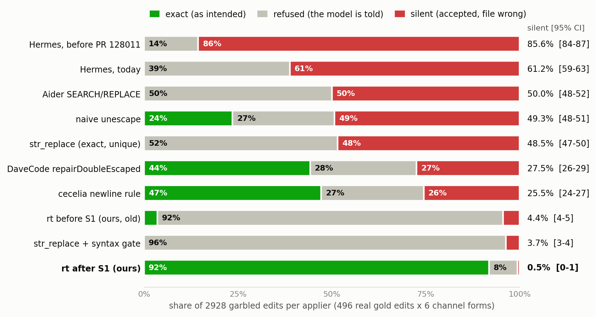

# Lost in the Pipe: EditBreak

Companion code and data for the Kaggle writeup **"Lost in the Pipe: How an agent harness taught a small model to break
its own edits, and a benchmark that catches it"** (Google – The Gemma 4 Developer Agent, Paper Track).

An agent harness hands tool output to the model JSON-escaped. The model copies those escapes back into its edits.
What happens next depends on the edit applier: it can **refuse** the garbled edit (the model is told and can retry),
or **accept** it and quietly write a file that isn't the one intended. EditBreak measures which one happens.

## What it measures

- **496 real edits** from the public patches of 116 tasks (fastapi, requests, rich, httpx), each with the exact file
  it should produce (`data/hunks.jsonl`, files in `data/files/`).
- **6 kinds of damage** seen in the wild: line breaks escaped, a whole extra JSON escape level, or stray line-end
  backslashes, in the new text only or in both texts. Plus the clean edit as a control.
- **10 appliers** given identical input: `str_replace` with and without a syntax check, the pinned source of Aider
  and of Hermes Agent before and after its escape-drift fix, DaveCode's repair, cecelia's rule, a naive unescape,
  and the author's editor `rt` before and after its fix.
- Each result is **exact**, **refused**, or **silent** (accepted, wrong file). Two fake appliers check the
  benchmark itself: one that plants a wrong character must score 100% silent, one that refuses everything 100%
  refused.

## Results (2,928 garbled edits per applier)

| applier | silent (wrong file) [95% CI] | exact | refused |
|---|---|---|---|
| Hermes, before its fix | 85.6% [84.3–86.8] | 0% | 14.4% |
| Hermes, today | 61.2% [59.4–63.0] | 0% | 38.8% |
| Aider | 50.0% [48.2–51.8] | 0% | 50.0% |
| naive unescape | 49.3% [47.5–51.1] | 23.5% | 27.2% |
| str_replace | 48.5% [46.7–50.3] | 0% | 51.5% |
| DaveCode | 27.5% [25.9–29.1] | 44.2% | 28.3% |
| cecelia rule | 25.5% [24.0–27.2] | 47.2% | 27.3% |
| rt, before the fix | 4.4% [3.7–5.2] | 3.6% | 92.0% |
| str_replace + syntax check | 3.7% [3.1–4.4] | 0% | 96.3% |
| **rt, after the fix** | **0.5% [0.3–0.9]** | **91.8%** | 7.6% |

Per-case outcomes for every applier are in `results/results.json`; the full tables in `results/table.md`.



## Reproduce

Tested with Python 3.13.7 (the parser's view of "still compiles" follows the running Python version) and
matplotlib 3.10.8. The benchmark itself needs only the standard library.

```bash
python vendor/fetch_cecelia.py                # once: downloads cecelia's GPL-3.0 file (pinned, hash-checked)
python editbreak/run.py --workers 6           # about 30 min; the fuzzy matchers are the slow part
python editbreak/report.py results/rerun.json # controls first, then the tables
python editbreak/report.py                    # the published run, including rt
pip install -r requirements.txt
python editbreak/figures.py                   # Figures 4 and 5 of the writeup (with a computed layout check)
python editbreak/figures_controls.py          # the layout check's own controls
```

`--limit N` runs only the first N edits. On the first 40 edits (280 cases, 2,800 outcomes), a rerun matches the
published run on every outcome.

## Test your own edit applier

Write one function, `apply(content, old, new)`, that returns the new file text or `None` to refuse. Then:

```bash
python editbreak/run.py --only strict --applier path/to/mine.py:apply --out results/mine.json
python editbreak/report.py results/mine.json
python editbreak/figures.py results/mine.json   # optional: its own Figures 4 and 5
```

`--only` skips the slow built-in fuzzy matchers, so a full run of your applier on all 3,416 cases takes seconds to
minutes; the instrument controls always run and are checked before any number is printed. An exception inside your
function is counted as a crash, never as a refusal. `examples/my_applier.py` is a ready template: it re-implements
plain `str_replace`, so its outcomes must equal the built-in `strict` on every case (they do: 420 of 420 on the first
60 edits).

**About `rt`.** `rt` is part of the author's entry in the competition's main track, which runs until 2 December 2026,
so its source will be added after that date. Its outcomes are in the published `results/results.json`, and
`report.py` and `figures.py` read them from there.

## Is it everyone's bug? A scan of 712,785 public edit calls

`prevalence/scan.py` looks for the same newline drift in 67,074 public trajectories of a different model and
harness ([nebius/SWE-rebench-openhands-trajectories](https://huggingface.co/datasets/nebius/SWE-rebench-openhands-trajectories),
Qwen3-Coder-480B + OpenHands, CC-BY-4.0). Its detector is validated on EditBreak first (`python prevalence/scan.py
validate`: 0 false positives on 496 clean edits, every drifted edit caught). It flagged 69 of 712,785 edit calls, and
all 69 are legitimate (code that really contains `\n`, or a deliberate rewrite): **zero drift**. Every flagged call
and its classification are in `results/prevalence_scan.json`. The loop in the writeup needs both a channel that
escapes the template and a model that imitates it.

## Also here

- `results/channel_stats.json`: how many of the agent's real edit calls (live runs 5 to 13) carried a channel
  artifact, counted by two independent methods.
- `figures/`: all five figures of the writeup.

## Licence

Apache-2.0 for this repository's code. Vendored and downloaded third-party code, and the source-file snapshots, keep
their own licences: see `THIRD_PARTY_NOTICES.md` and `licenses/`.
